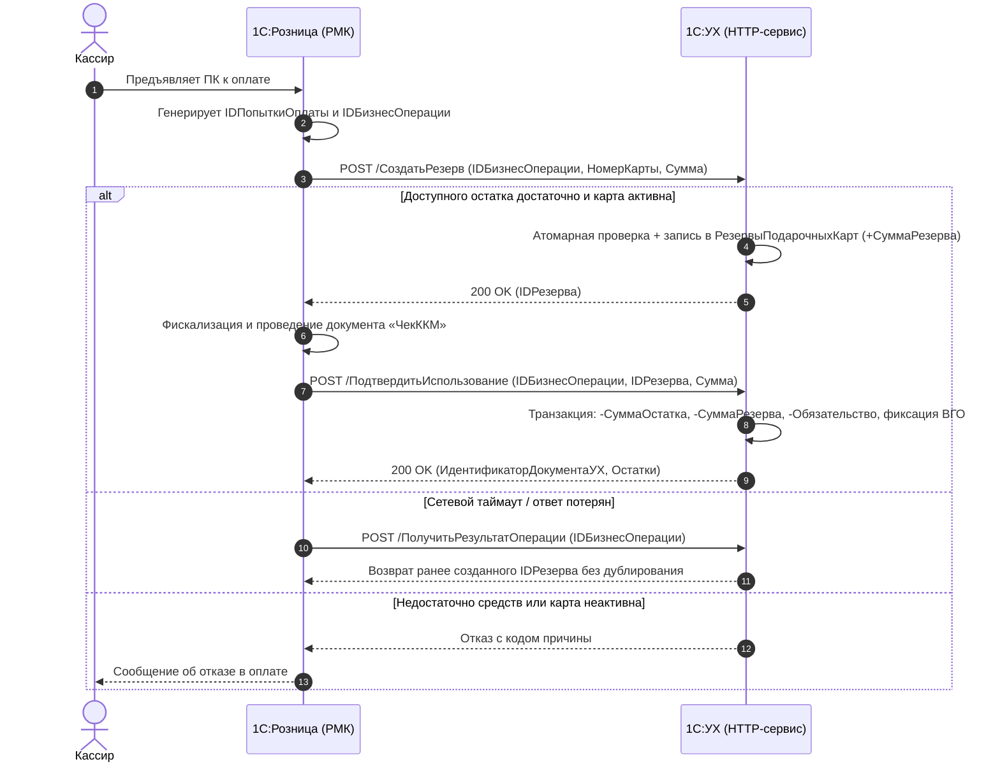

# Кейс: Автоматизация жизненного цикла подарочных карт и ВГО (1С:УХ ↔ 1С:Розница)

## 1. Контекст и проблема (AS IS)
В группе компаний отсутствовал единый реестр подарочных карт (ПК) и онлайн-контроль их остатков:
* Типовой механизм 1С:Розницы списывал полный номинал карты при первой покупке и блокировал её повторное использование.
* Сверка продаж, погашений и внутригрупповых оборотов (ВГО) проводилась бухгалтерией вручную в Excel по итогам закрытия смен.
* При сетевых сбоях на кассах возникал риск двойного списания средств или зависания резервов.

**Цель проекта:** построить в 1С:УХ мастер-систему поэкземплярного учёта подарочных карт с онлайн-интеграцией из 1С:Розницы (SLA ≤ 30 сек), атомарным резервированием и автоматическим формированием данных для ВГО.

**Моя роль на проекте:** сбор и формализация требований с финансовой службой и PO, моделирование процессов AS IS / TO BE (BPMN 2.0), проектирование структуры метаданных 1С:УХ и 1С:Розницы, описание контрактов REST API и механизмов отказоустойчивости, написание ЧТЗ (Dev Story) и приёмочных тест-кейсов.

---

## 2. Архитектурные решения

### 2.1. Модель данных в 1С:УХ
Чтобы сохранить историю изменений без перезаписи карточки и обеспечить быстрый расчёт остатков на кассе, данные разделены на 4 объекта:
1. **Справочник `ПодарочныеКарты`** — хранит только статические атрибуты: `НомерКарты`, `Номинал`, `ОрганизацияЭмитент`, `ДатаВыпуска`, `ИсходнаяКарта` (для цепочек замен).
2. **Периодический регистр сведений `СостоянияПодарочныхКарт`** — история изменения статусов (`ПоступилаНаСклад`, `ВыпущенаВОбращение`, `Активна`, `Заблокирована`, `Заменена`, `Просрочена`, `Аннулирована`), местонахождения и сроков действия.
3. **Регистр накопления `ОстаткиПодарочныхКарт`** — учёт фактического остатка (`СуммаОстатка`) и заблокированных средств (`СуммаРезерва`).  
   $$\text{ДоступныйОстаток} = \text{СуммаОстатка} - \text{СуммаРезерва}$$
4. **Регистр накопления `ОбязательстваПоПодарочнымКартам`** — учёт финансового обязательства перед держателем строго на организации-эмитенте (независимо от того, в каком юрлице группы карта принята к оплате).

### 2.2. Обеспечение идемпотентности и отказоустойчивости
Для защиты от дублей при потере ответа или повторе запросов введена двухуровневая идентификация:
* **`IDПопыткиОплаты` (UUID)** — генерируется в чеке ККМ при добавлении строки оплаты (не зависит от меняющегося `НомерСтроки`).
* **`IDБизнесОперации`** — связывает этапы одной попытки (`СоздатьРезерв` → `ПодтвердитьИспользование` / `ОтменитьРезерв`). При повторной попытке оплаты после подтверждённой отмены генерируется новый идентификатор.
* **`UUIDСобытия` (`IDОперации`)** — уникальный ключ конкретного HTTP-запроса в журналах интеграции (`ЖурналИнтеграцииСУХ` и `ЖурналИнтеграцииУХ`).

---

## 3. Схема взаимодействия систем (Sequence Diagram)

---

## 4. Пример контракта REST API (`ПодтвердитьИспользование`)

| Параметр | Направление | Тип | Описание |
| :--- | :--- | :--- | :--- |
| `UUIDСобытия` | Запрос | `String (36)` | Уникальный идентификатор HTTP-сообщения |
| `IDБизнесОперации` | Запрос | `String (36)` | Ключ попытки оплаты из строки `ЧекККМ` |
| `IDРезерва` | Запрос | `String (36)` | Идентификатор закрываемого резерва |
| `НомерКарты` | Запрос | `String` | Код подарочной карты |
| `СуммаСписания` | Запрос | `Decimal (15,2)` | Факчески оплаченная сумма из регистра `ОплатаПодарочнымиСертификатами` |
| `ОрганизацияПогашения` | Запрос | `String` | Юрлицо кассы (кредитор по ВГО) |
| `СтатусОбработки` | Ответ | `String` | `Успешно` / `Ошибка` |
| `ФактическийОстаток` | Ответ | `Decimal (15,2)` | Остаток номинала после списания |
| `ДоступныйОстаток` | Ответ | `Decimal (15,2)` | Остаток с учётом других активных резервов |

---

## 5. Контрольные сценарии приёмки (UAT)

| № | Сценарий | Ожидаемый результат в 1С:УХ |
| :--- | :--- | :--- |
| **1** | **Частичная оплата** (карта 3 000 ₽, покупка 1 200 ₽) | Фактический и доступный остаток: `1 800 ₽`. Карта остаётся активной для следующих покупок. |
| **2** | **Конкурентный доступ** (на карте 1 000 ₽, две кассы одновременно просят по 800 ₽) | Первый запрос создаёт резерв на `800 ₽` (доступный остаток `200 ₽`), второй получает атомарный отказ. |
| **3** | **Потеря ответа при резервировании** | Повторный запрос с тем же `IDБизнесОперации` возвращает исходный `IDРезерва`, второй резерв не создаётся. |
| **4** | **Замена карты при активном резерве** | Операция замены отклоняется до выяснения исхода оплаты (подтверждения или отмены резерва). |
| **5** | **Использование карты в другом юрлице (ВГО)** | Обязательство уменьшается у организации-эмитента; в витрине ВГО фиксируются должник и кредитор. |

---

## 6. Достигнутые результаты
* **Скорость:** время синхронизации кассовых операций с 1С:УХ сокращено до **≤ 30 секунд**.
* **Надёжность:** полностью исключены двойные списания и потери транзакций при обрывах связи.
* **Эффективность:** трудозатраты бухгалтерии на ежемесячную сверку сертификатов и ВГО снижены на **80%**.
